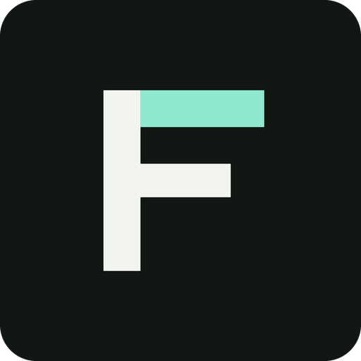
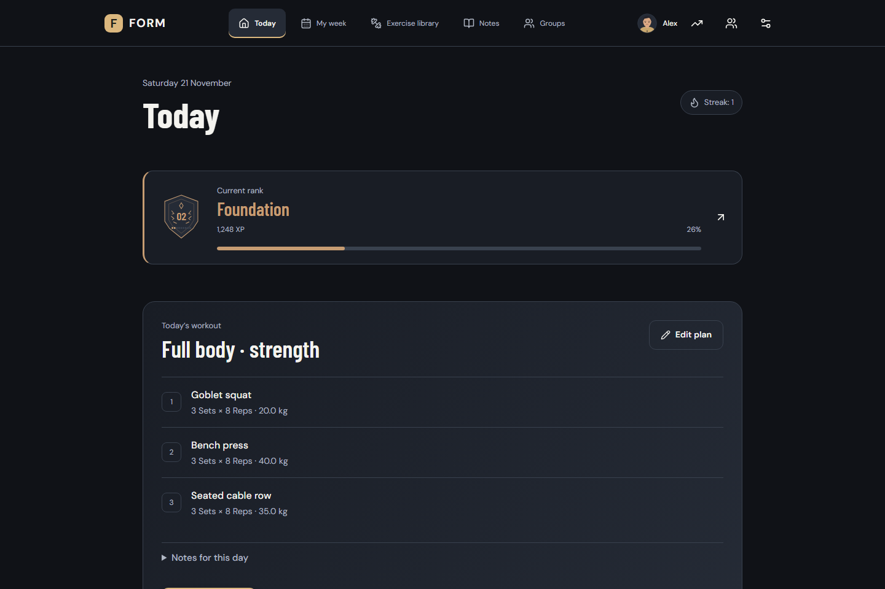
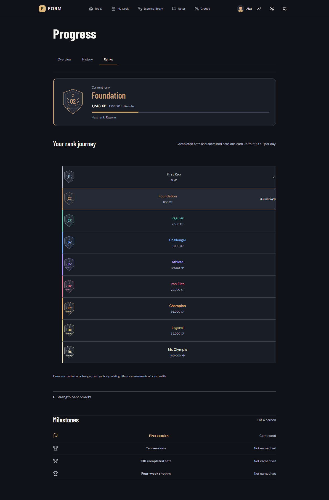
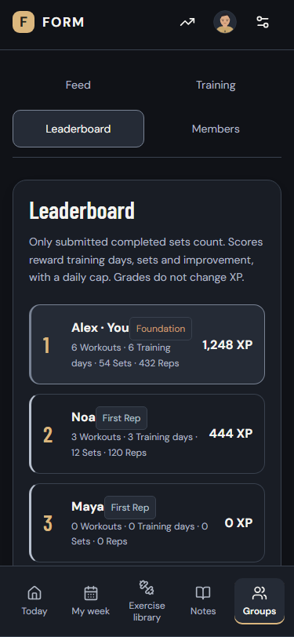
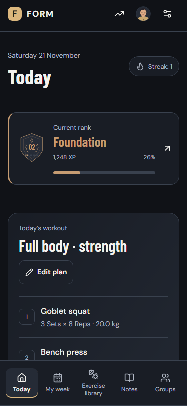

<div align="center">
  
  <h1>FORM GYM</h1>
  <p><strong>Build strength. Keep your data. Train your way.</strong></p>
  <p>Offline-first workout planning and progress tracking for Windows and Android.</p>
  <p>
    <a href="https://github.com/RadekParek/FORM-Gym/releases/latest"></a>
    <a href="LICENSE"></a>
    <a href="https://github.com/RadekParek/FORM-Gym/releases"></a>
  </p>
  <p>
    <a href="https://github.com/RadekParek/FORM-Gym/releases/download/v1.2.0/GYM.app.exe"><strong>↓ WINDOWS APP</strong></a>
    &nbsp; · &nbsp;
    <a href="https://github.com/RadekParek/FORM-Gym/releases/download/v1.2.0/FORM.Gym.apk"><strong>↓ ANDROID APK</strong></a>
    &nbsp; · &nbsp;
    <a href="https://github.com/RadekParek/FORM-Gym/releases/tag/v1.2.0"><strong>RELEASE NOTES</strong></a>
  </p>
</div>

---

## Training, without the noise.

FORM Gym keeps the essentials close: plan a session, log the work, see your progress. Your personal training stays on your device and works offline. No account is needed to plan, train, save notes, or review your history.

| Train | Progress | Groups |
|:---:|:---:|:---:|
|  |  |  |
| **Your day, at a glance** | **A clearer view of progress** | **Groups when you want them** |

<details>
<summary><strong>See the mobile layout</strong></summary>
<br />
<p align="center"></p>
</details>

## Made for the long game

- **Plan your week** — exercises, sets, reps, load, rest, and day notes.
- **Train offline** — start or resume sessions and keep your records without a connection.
- **Explore 45 exercises** — animated movement guides, form cues, muscle maps, search, and favorites.
- **Make progress visible** — training history, personal records, ranks, milestones, and daily quests.
- **Keep useful notes** — categories, checklists, automatic saving, recovered drafts, and undo.
- **Back up on your terms** — export and restore your training data as JSON.
- **Choose your setup** — dark or light appearance, multiple languages, units, larger text, and reduced motion.
- **Train with a crew** — optional shared groups, assignments, chat, reviews, and member-reported leaderboards.

## Downloads · v1.2.0

| Platform | Download | Requirements |
|:--|:--|:--|
| **Windows x64** | [GYM.app.exe](https://github.com/RadekParek/FORM-Gym/releases/download/v1.2.0/GYM.app.exe) | Portable app; Microsoft Edge WebView2 Evergreen Runtime |
| **Android** | [FORM.Gym.apk](https://github.com/RadekParek/FORM-Gym/releases/download/v1.2.0/FORM.Gym.apk) | Android 6.0 or newer |
| **Source bundle** | [FORM-source.zip](https://github.com/RadekParek/FORM-Gym/releases/download/v1.2.0/FORM-source.zip) | Source code and build instructions |

**Windows:** download and open the portable executable. Personal data is saved locally under `%APPDATA%\FORM Gym\training.json`.

**Android:** download the APK and open it to install or update. This release uses the same signing certificate as v1.1.0, so compatible updates preserve the normal Android update path. The private signing key is intentionally not included.

> Windows releases are unsigned and may show a SmartScreen warning. Android emulator startup was unavailable during this release, so a native emulator runtime check was not completed.

### Verify your download

SHA-256 checksums for the exact release files are published in [`FORM-Gym-validation.json`](FORM-Gym-validation.json) and the [v1.2.0 release notes](https://github.com/RadekParek/FORM-Gym/releases/tag/v1.2.0).

## Privacy, by design

Your personal training plan, measurements, health details, notes, and workout history stay local by default. FORM Gym has no telemetry, and offline training requires no account, API key, or online service.

Sharing is optional. If you choose to use an online community server, only the workout summaries and quest results you submit are shared. Private notes, measurements, and health details are not sent. The released apps do **not** connect to a developer's PC or include its local server data. Online groups and the global leaderboard require an HTTPS server that you configure; see [`source/docs/community-hosting.md`](source/docs/community-hosting.md). Groups can also run on your local network.

Purchases are disabled in this build. Any premium labels in the app do not charge you.

## Build from source

Requirements: Node.js 22 or newer. Android builds also need Java 21 and Android SDK 35.

```sh
cd source
npm ci
npm run build
npm test
npm run test:groups
```

Build Windows with `npm run package:win`. For Android, configure `android/local.properties`, run `npm run android:sync`, then build from the Android folder with `gradlew.bat assembleRelease`. Keep the local Android signing configuration and signing key private.

More development, platform, and test notes are in [`source/README.md`](source/README.md).

## License

FORM Gym source is licensed under the [MIT License](LICENSE). Third-party packages and bundled assets retain their respective licenses.
